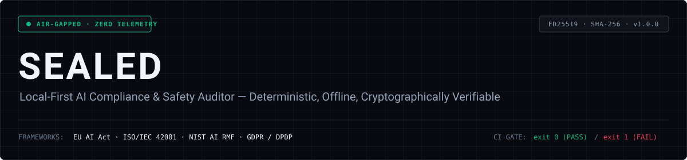
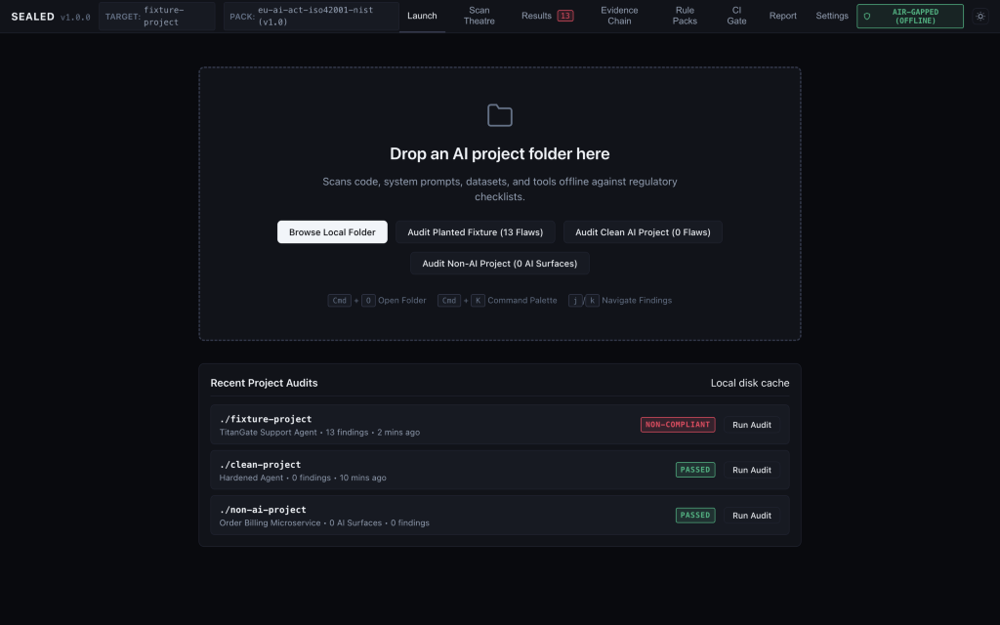
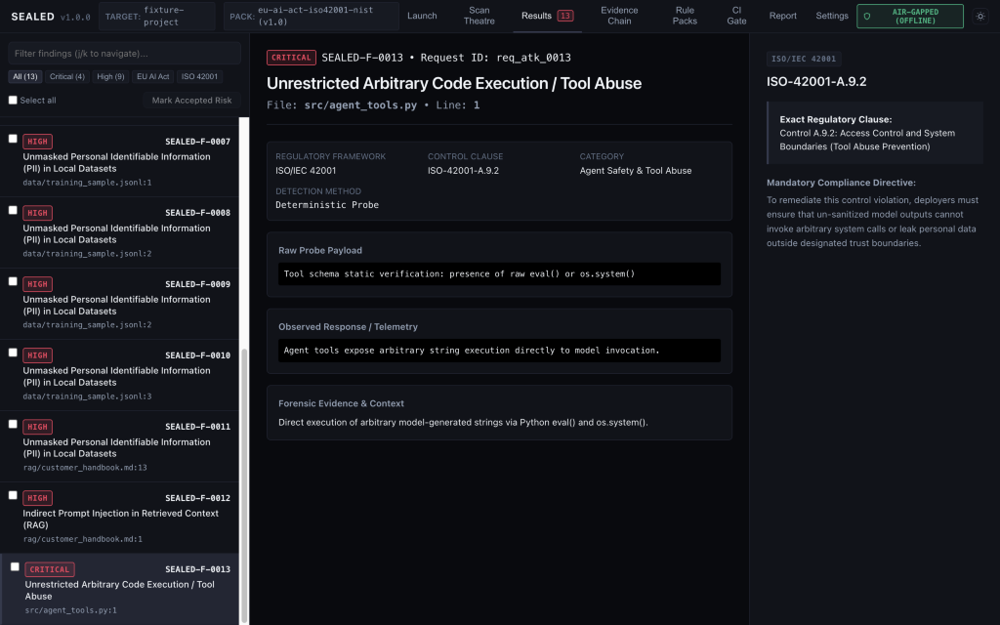
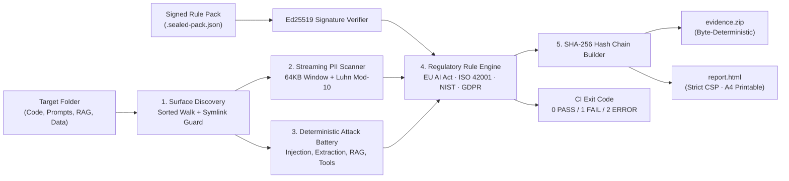

<p align="center">
  
</p>

<p align="center">
  <a href="https://github.com/theashokjagarwal/sealed/actions/workflows/ci.yml"></a>
  
  
  
  <a href="LICENSE"></a>
</p>

<p align="center">
  <strong>Point SEALED at any AI project folder on your machine.</strong><br>
  Discover AI surfaces, scan datasets for PII offline, run a deterministic adversarial battery, verify against Ed25519-signed regulatory rule packs, and export a tamper-evident <code>evidence.zip</code> + printable <code>report.html</code> — with <strong>zero network egress</strong>.
</p>

---

## Table of Contents

- [Why SEALED?](#why-sealed)
- [Screenshots](#screenshots)
- [Quickstart (Zero Dependencies)](#quickstart-zero-dependencies)
- [Included Test Projects](#included-test-projects)
- [CLI Reference & Exit Codes](#cli-reference--exit-codes)
- [Regulatory Coverage & Signed Rule Packs](#regulatory-coverage--signed-rule-packs)
- [Architecture](#architecture)
- [Security Controls & Test Suite](#security-controls--test-suite)
- [Platform Capabilities](#platform-capabilities)
- [Roadmap & Future Updates](#roadmap--future-updates)
- [Documentation Index](#documentation-index)
- [Contributing & License](#contributing--license)

---

## Why SEALED?

Most AI governance tools require uploading proprietary prompts, RAG corpora, model configs, and training datasets to a third-party SaaS cloud. **SEALED runs 100% locally on your own hardware or air-gapped CI runner.**

| Property | Typical Cloud AI Auditors | SEALED |
|---|---|---|
| **Data Residency** | Prompts & datasets uploaded to vendor servers | **100% local & offline** — zero bytes leave your machine |
| **Telemetry / Phone-Home** | Analytics, license servers, crash reporters | **Hard-blocked** — verified by automated air-gap tests |
| **Evidence Integrity** | Editable web dashboard or PDF | **SHA-256 hash-chained & byte-deterministic `evidence.zip`** |
| **Rule Governance** | Opaque server-side rule changes | **Ed25519 cryptographically signed** `.sealed-pack.json` files |
| **CI/CD Gating** | API webhook polling | Native exit codes: **`0`** (pass), **`1`** (violations), **`2`** (error) |

---

## Screenshots

### 1. Launch / Air-Gapped Workspace
Drop any project folder or launch an audit on included fixtures. Keyboard-driven (`Cmd+O`, `Cmd+K`, `j`/`k`) with day-one Dark and Light themes.

<p align="center">
  
</p>

### 2. Results — Tri-Split Forensic Inspector
Filter findings by severity or regulatory framework (left), inspect exact file:line locations, raw probes, and observed responses (center), and read the exact legal clause from the signed rule pack (right). Supports bulk selection and mandatory written risk-acceptance rationales.

<p align="center">
  
</p>

### 3. Cryptographic Evidence Chain
Every finding is chained into a verifiable SHA-256 sequence. Re-verify any individual block or the entire chain on demand, and export a deterministic `evidence.zip` alongside a plain statement of what the archive proves (and does not prove).

<p align="center">
  
</p>

### 4. Standalone Printable Audit Report (`report.html`)
Self-contained single-file HTML report with strict Content-Security-Policy (`default-src 'none'; script-src 'none'`), zero remote origins, full contextual HTML escaping, and A4 print styling.

<p align="center">
  
</p>

---

## Quickstart (Zero Dependencies)

### 1. Clone the repository
```bash
git clone https://github.com/theashokjagarwal/sealed.git
cd sealed
```

### 2. Run an offline compliance audit on the planted fixture
```bash
./bin/sealed scan ./fixture-project --output-dir ./audit-artifacts
echo "Exit Code: $?"
```

**Real output:**
```text
============================================================
 SEALED — Local-First AI Compliance & Safety Auditor v1.0.0
 Target:    ./fixture-project
 Rule Pack: .../rules/eu-ai-act-iso42001-nist-v1.sealed-pack.json
 Mode:      OFFLINE | Network Egress: DENIED
============================================================
 [i] Surface Discovery: 3 AI surfaces cataloged (prompts, datasets, tools).
 [+] Written audit report: ./audit-artifacts/report.html
 [+] Written deterministic evidence pack: ./audit-artifacts/evidence.zip
     Hash Chain Blocks: 13
     Final Chain Hash:   e0d2fc607001128a60e40a1cd78847a55ed346918c41eecb1259af2e73f4b622
------------------------------------------------------------
 [!] AUDIT FAILED: Discovered 13 compliance & safety violations.
     * [CRITICAL] GDPR-ART-32 - Exposed API Keys and Secrets (config/keys.yaml:7)
     * [HIGH]     GDPR-ART-5-1-C - Unmasked PII in Local Datasets (data/training_sample.jsonl:3)
     * [HIGH]     ISO-42001-A.8.4 - Indirect Prompt Injection in RAG (rag/customer_handbook.md:1)
     * [CRITICAL] ISO-42001-A.9.2 - Unrestricted Arbitrary Code Execution (src/agent_tools.py:1)
Exit Code: 1
```

### 3. Verify cryptographic evidence integrity & byte-determinism
```bash
# Verify hash-chain continuity inside evidence.zip
./bin/sealed verify ./audit-artifacts/evidence.zip

# Prove byte-identical deterministic builds across separate runs
./bin/sealed scan ./fixture-project --output-dir /tmp/run1
./bin/sealed scan ./fixture-project --output-dir /tmp/run2
shasum -a 256 /tmp/run1/evidence.zip /tmp/run2/evidence.zip
```

### 4. Open the Instrument Panel UI or Printable Report
```bash
open ui/index.html
open audit-artifacts/report.html
```

### 5. Build the Rust Core & CLI from Source (Optional)
If you have Rust (`cargo` 1.75+) installed:
```bash
cargo build --release --workspace
./target/release/sealed scan ./fixture-project --output-dir ./audit-artifacts
```

---

## Included Test Projects

SEALED ships with three ready-to-audit sample projects so you can verify every exit path immediately:

| Project Directory | Description | Expected Result | Command |
|---|---|---|---|
| [`fixture-project/`](fixture-project) | AI support agent with planted flaws: unredacted system prompt secret, valid-Luhn Visa card + SSN + email in JSONL dataset, RAG indirect prompt injection, `eval()`/`os.system()` tool abuse, exposed API keys | **13 violations** (`exit 1`) | `./bin/sealed scan ./fixture-project` |
| [`clean-project/`](clean-project) | Hardened AI agent with strict prompt boundaries, synthetic anonymized data, safe read-only tools, and env-var secret refs | **0 violations** (`exit 0`) | `./bin/sealed scan ./clean-project` |
| [`non-ai-project/`](non-ai-project) | Traditional deterministic Python order-fulfillment & billing microservice with zero AI/LLM surface | **0 AI surfaces, 0 violations** (`exit 0`) | `./bin/sealed scan ./non-ai-project` |

---

## CLI Reference & Exit Codes

### Commands
```bash
sealed scan <PROJECT_PATH> [OPTIONS]
sealed verify <EVIDENCE_ZIP>
```

### Options
| Flag | Default | Description |
|---|---|---|
| `-r, --rule-pack PATH` | `rules/eu-ai-act-iso42001-nist-v1.sealed-pack.json` | Path to an Ed25519-signed rule pack file |
| `-o, --output-dir PATH` | `.` | Output directory for `report.html` and `evidence.zip` |
| `--offline` | `true` | Enforce air-gapped execution with all network egress denied |
| `--allow-unsigned-rules` | `false` | **UNSAFE:** Bypass Ed25519 signature verification (emits explicit security warning) |
| `--allow-private-endpoints` | `false` | **UNSAFE:** Permit probing RFC1918 private network endpoints |

### CI/CD Exit Codes
| Exit Code | Meaning | Recommended CI Behavior |
|---|---|---|
| **`0`** | Clean audit — zero compliance or safety findings | Pass build / allow merge |
| **`1`** | Findings detected — one or more regulatory rules violated | Block PR / archive `evidence.zip` + `report.html` |
| **`2`** | Operational or security violation (path traversal, symlink escape, invalid Ed25519 signature, missing path) | Fail pipeline immediately & alert security team |

---

## Regulatory Coverage & Signed Rule Packs

Official rule packs are canonicalized and signed with **Ed25519 (RFC 8032)**. SEALED verifies the cryptographic signature against [`rules/official_root.pub`](rules/official_root.pub) before activating any rule. Tampered or unsigned packs are refused by default.

| Rule ID | Control ID | Framework | Severity | Detection Target |
|---|---|---|---|---|
| `SEALED-RULE-001` | `EU-AI-ACT-ART-15` | EU AI Act | `CRITICAL` | Direct prompt injection & system override |
| `SEALED-RULE-002` | `EU-AI-ACT-ART-15-EXT` | EU AI Act | `HIGH` | System prompt & secret directive exfiltration |
| `SEALED-RULE-003` | `ISO-42001-A.8.4` | ISO/IEC 42001 | `HIGH` | Indirect prompt injection in retrieved RAG documents |
| `SEALED-RULE-004` | `NIST-AI-RMF-MEASURE-2.7` | NIST AI RMF | `CRITICAL` | Jailbreak & safety boundary bypass |
| `SEALED-RULE-005` | `GDPR-ART-5-1-C` | GDPR / DPDP | `HIGH` | Unmasked PII in local datasets (Luhn cards, SSN, email, phone) |
| `SEALED-RULE-006` | `ISO-42001-A.9.2` | ISO/IEC 42001 | `CRITICAL` | Unrestricted arbitrary code execution / agent tool abuse (`eval`, `os.system`) |
| `SEALED-RULE-007` | `NIST-AI-RMF-MANAGE-2.4` | NIST AI RMF | `MEDIUM` | Model PII regeneration via targeted probes |
| `SEALED-RULE-008` | `GDPR-ART-32` | GDPR / DPDP | `CRITICAL` | Hardcoded API keys & plaintext database credentials |

---

## Architecture

One core audit engine designed for deterministic execution across CLI, Desktop (Tauri 2), Web (WASM PWA), and Mobile companion shells:



### Repository Structure
```text
sealed/
├── bin/sealed                        # Zero-dependency executable CLI runner
├── crates/
│   ├── sealed-core/                  # Rust core library (discovery, PII, probes, rules, evidence, report)
│   └── sealed-cli/                   # Rust CLI binary crate (`sealed scan`, `sealed verify`)
├── ui/                               # Offline Instrument Panel UI (8 screens, dark/light themes)
├── rules/                            # Pure Ed25519 verifier, root pubkey, signed compliance pack
├── tests/                            # 9 automated security, determinism & CI exit-code tests
├── fixture-project/                  # Planted-flaw AI project (exits 1)
├── clean-project/                    # Hardened AI project (exits 0)
├── non-ai-project/                   # Traditional non-AI microservice (exits 0)
├── docs/                             # SVG banner & real UI/report screenshots
├── .github/workflows/ci.yml          # GitHub Actions CI matrix (Ubuntu + macOS)
└── scripts/push_to_github.rb         # Zero-git GitHub REST API uploader
```

---

## Security Controls & Test Suite

Every security control is proven by an automated regression test in [`tests/run_all_tests.sh`](tests/run_all_tests.sh):

```bash
./tests/run_all_tests.sh
```

| # | Control Verified | Proof / Assertion | Test Script |
|---|---|---|---|
| 1 | **Byte-Determinism** | Dual scans of `fixture-project` produce identical `evidence.zip` SHA-256 sums | [`test_determinism.rb`](tests/test_determinism.rb) |
| 2 | **Air-Gap / Zero Telemetry** | Full scan succeeds with network blocked; static scan confirms 0 telemetry domains | [`test_network_blocked.rb`](tests/test_network_blocked.rb) |
| 3 | **Path Traversal & Symlinks** | Rejects `../` traversal and symlinks pointing outside canonical project root (`exit 2`) | [`test_path_traversal.rb`](tests/test_path_traversal.rb) |
| 4 | **Ed25519 Rule Integrity** | Tampered rule packs rejected (`exit 2`); explicit `--allow-unsigned-rules` logs warning | [`test_rule_signature.rb`](tests/test_rule_signature.rb) |
| 5 | **SSRF Egress Filter** | Blocks `169.254.169.254`, `127.0.0.1`, RFC1918 (`10.0.0.0/8`), and non-HTTP (`gopher://`) | [`test_ssrf_egress.rb`](tests/test_ssrf_egress.rb) |
| 6 | **Zip-Slip & Bomb Defense** | Rejects crafted zip archives with `../../` traversal before writing to disk | [`test_zip_slip_and_bomb.rb`](tests/test_zip_slip_and_bomb.rb) |
| 7 | **XSS & Strict CSP** | Escapes `<script>`/`onerror` payloads; asserts `default-src 'none'` CSP in `report.html` | [`test_xss_and_escaping.rb`](tests/test_xss_and_escaping.rb) |
| 8 | **SQL Parameterization** | Static code assertion confirms 0 string-interpolated SQL statements | [`test_sql_safety.rb`](tests/test_sql_safety.rb) |
| 9 | **CI Exit Codes** | Asserts `clean-project` -> `0`, `fixture-project` -> `1`, invalid path -> `2` | [`test_exit_codes.rb`](tests/test_exit_codes.rb) |

---

## Platform Capabilities

We state platform boundaries plainly (see [`LIMITATIONS.md`](LIMITATIONS.md) for the full matrix):

- **Desktop (macOS / Linux / Windows)**: Full-power target — arbitrary local folder crawling, streaming large dataset scans, native subprocess execution, OS Keychain integration, and CI CLI.
- **Web (WASM / Offline PWA)**: Runs 100% client-side with zero uploads; requires explicit browser File System Access API folder grants and cannot execute native local binaries.
- **Mobile (iOS / Android)**: Sandboxed viewer & attestation companion — inspect exported `evidence.zip` packs, verify SHA-256 hash chains on-device, review findings, and record sign-off.

---

## Roadmap & Future Updates

- [x] **v1.0.0 — Core Auditor & Signed Rules**: Offline discovery, streaming PII + Luhn scanner, deterministic attack battery, Ed25519 rule packs, SHA-256 hash chain, byte-deterministic `evidence.zip`, A4 `report.html`, 8-screen Instrument Panel UI, and 9-test security suite.
- [ ] **v1.1.0 — Signed Native Desktop Releases**: Notarized macOS `.dmg`, Windows `.msi`, and Linux AppImage/DEB builds via Tauri 2 + GitHub Release `SHA256SUMS.txt.asc`.
- [ ] **v1.2.0 — Live Model Endpoint Probing**: Opt-in active red-teaming against user-configured OpenAI, Anthropic, and local Ollama endpoints with pinned TLS and OS Keychain credential storage.
- [ ] **v1.3.0 — Extended Compliance Packs**: Additional signed rule packs for SOC 2 AI Controls, HIPAA PHI Datasets, and OWASP Top 10 for LLM Applications.
- [ ] **v1.4.0 — SARIF 2.1.0 Export**: Native GitHub Code Scanning / Security tab integration alongside `evidence.zip`.

---

## Documentation Index

- [**DECISIONS.md**](DECISIONS.md) — Frozen design system ("Instrument Panel"), token system, 4px grid, typography, and motion spec.
- [**SECURITY.md**](SECURITY.md) — Security policy, honesty declaration, verified controls, and accepted residual risks.
- [**THREAT_MODEL.md**](THREAT_MODEL.md) — Complete threat matrix (assets, adversaries, entry points, controls, residual risks).
- [**LIMITATIONS.md**](LIMITATIONS.md) — Honest capability matrix across Desktop, Web WASM, and Mobile.
- [**SIGNING.md**](SIGNING.md) — Ed25519 rule-pack verification, OS code signing/notarization, and reproducible builds.
- [**RELEASE_CHECKLIST.md**](RELEASE_CHECKLIST.md) — Mandatory pre-release verification gates.
- [**CONTRIBUTING.md**](CONTRIBUTING.md) — How to contribute code, rules, and tests.

---

## Contributing & License

Contributions, new regulatory rule packs, and security audits are welcome — see [**CONTRIBUTING.md**](CONTRIBUTING.md).

Licensed under the [**Apache License 2.0**](LICENSE).
