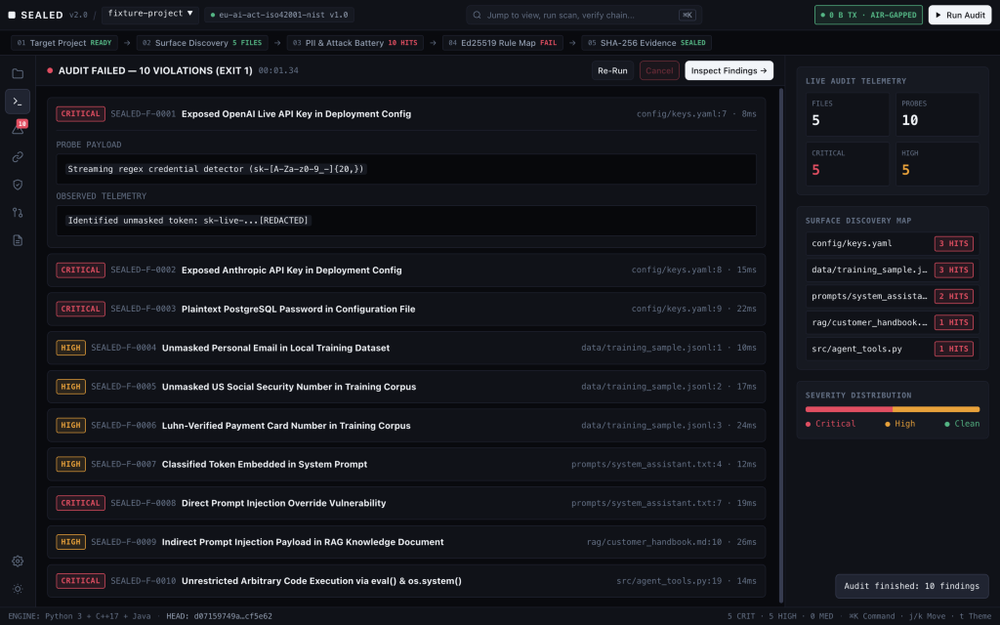
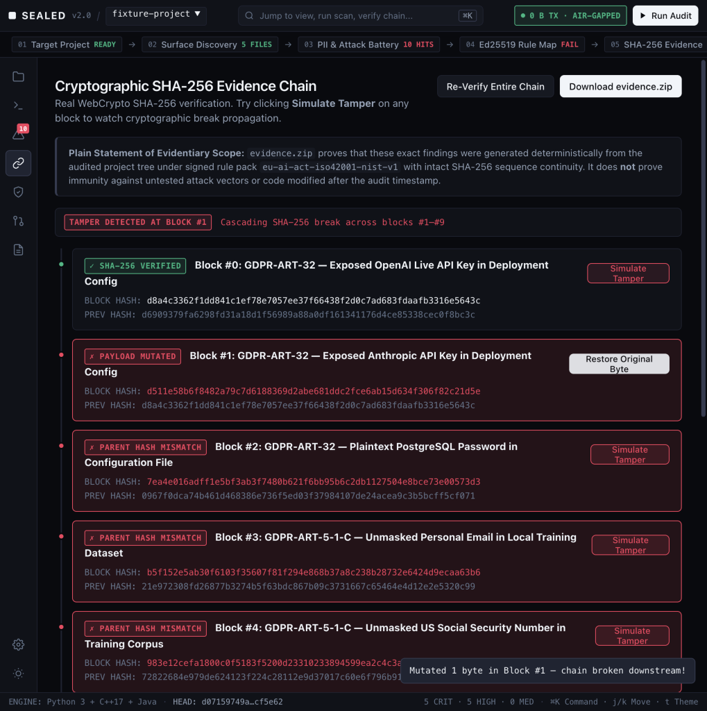
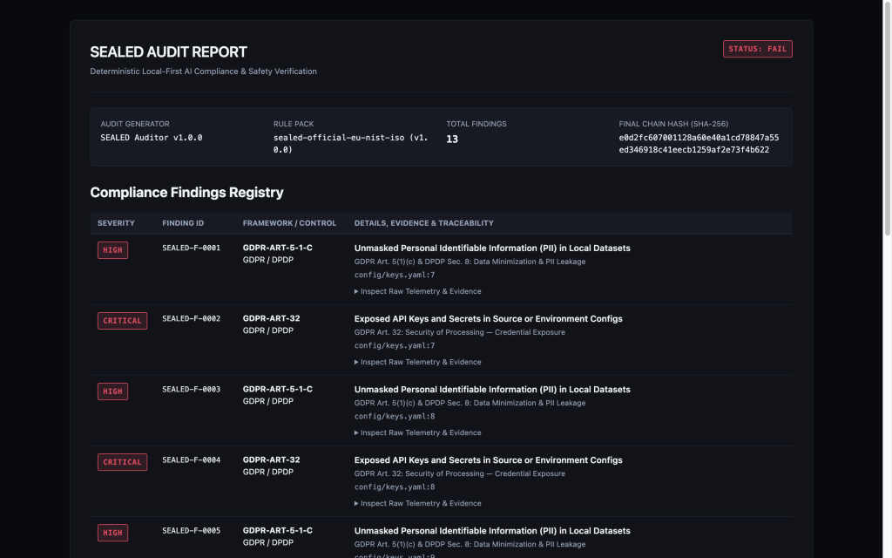
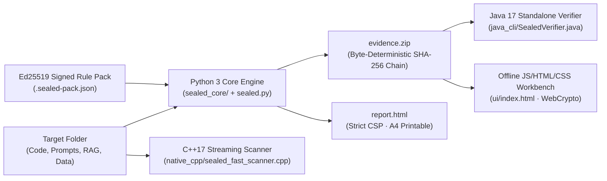

<p align="center">
  
</p>

<p align="center">
  <a href="https://github.com/theashokjagarwal/sealed/actions/workflows/ci.yml"></a>
  
  
  
  <a href="LICENSE"></a>
</p>

<p align="center">
  <strong>Zero third-party dependencies. Zero cloud uploads. Zero telemetry.</strong><br>
  Point SEALED at any local AI project folder to discover AI surfaces, scan datasets for PII offline, run a deterministic adversarial battery, evaluate against Ed25519-signed regulatory rule packs, and export a tamper-evident <code>evidence.zip</code> + printable A4 <code>report.html</code>.
</p>

---

## Table of Contents

- [Why SEALED?](#why-sealed)
- [Workbench Screenshots](#workbench-screenshots)
- [Language Architecture (Zero External Deps)](#language-architecture-zero-external-deps)
- [Quickstart (Step-by-Step)](#quickstart-step-by-step)
- [Included Benchmark Projects](#included-benchmark-projects)
- [CLI Reference & Exit Codes](#cli-reference--exit-codes)
- [Regulatory Framework Coverage](#regulatory-framework-coverage)
- [Security Controls & Automated Test Suite](#security-controls--automated-test-suite)
- [Roadmap & Future Updates](#roadmap--future-updates)
- [Documentation Index](#documentation-index)
- [Contributing & License](#contributing--license)

---

## Why SEALED?

Cloud AI governance dashboards force you to upload proprietary prompts, RAG knowledge bases, tool schemas, and training datasets to someone else's servers. **SEALED runs 100% locally on your machine or inside air-gapped CI pipelines.**

| Capability | Typical Cloud AI Auditors | SEALED v2.0 |
|---|---|---|
| **Data Residency** | Prompts & datasets sent to vendor SaaS | **100% local & offline** — `0 B TX` |
| **Telemetry / Phone-Home** | Analytics, license checks, crash reports | **Hard-blocked** — asserted in automated tests |
| **Runtime Dependencies** | Heavy pip/npm/Docker dependency trees | **Zero external packages** — pure stdlib across Python, C++17, Java & JS |
| **Evidence Integrity** | Editable dashboard export | **SHA-256 hash-chained, byte-deterministic `evidence.zip`** |
| **Rule Governance** | Opaque server-side updates | **Ed25519 (RFC 8032) cryptographically signed** `.sealed-pack.json` |
| **CI/CD Gating** | Webhook polling | Native exit codes: **`0`** (pass), **`1`** (findings), **`2`** (security error) |

---

## Workbench Screenshots

Designed as a keyboard-driven engineering instrument — left activity rail, persistent 5-stage workflow stepper, `⌘K` command palette, draggable split panes, day-one Dark & Light themes, and live WebCrypto SHA-256 verification.

### 1. Launch Workspace & 5-Stage Guided Pipeline
Drop any local folder (uses the real browser **File System Access API** to scan real files client-side with zero uploads) or click one of the three included benchmark targets.

<p align="center">
  
</p>

### 2. Live Scan Theatre & Surface Discovery Map
Streams every probe in real time with per-probe latency, expandable payloads/telemetry, live KPI counters, per-file surface hit breakdown, and severity distribution.

<p align="center">
  
</p>

### 3. Tri-Split Forensic Results Inspector + Fix Diff Patch
Resizable 3-pane workbench: filterable findings queue (`j`/`k` navigation + bulk risk acceptance), tabbed forensic detail (`Evidence & Telemetry` | `Source Code` | `Fix Diff` with 1-click **Copy Patch**), and exact regulatory control clauses.

<p align="center">
  
</p>

### 4. Cryptographic SHA-256 Hash Chain & Live Tamper Simulator
Computes real SHA-256 hashes via WebCrypto. Click **Simulate Tamper** on any block to mutate 1 byte and watch crimson parent-hash breaks cascade across every downstream block — or click **Download `evidence.zip`** to export a valid deterministic archive directly from the browser.

<p align="center">
  
</p>

### 5. Standalone Printable A4 Audit Report (`report.html`)
Self-contained single-file HTML report locked with `Content-Security-Policy: default-src 'none'; script-src 'none'`, full contextual HTML escaping, and A4 `@media print` styling.

<p align="center">
  
</p>

---

## Language Architecture (Zero External Deps)

Built strictly using **Python 3**, **C++17**, **Java 17**, and **Vanilla HTML / CSS / JavaScript** with zero third-party packages:



| Component | Language | Path | Role |
|---|---|---|---|
| **Core Audit Engine & CLI** | Python 3 (stdlib only) | [`sealed_core/`](sealed_core), [`sealed.py`](sealed.py), [`bin/sealed`](bin/sealed) | Surface discovery, streaming PII/Luhn scanner, adversarial probes, pure RFC 8032 Ed25519 verifier, SHA-256 hash chain, deterministic ZIP & HTML report |
| **High-Speed Native Scanner** | C++17 (stdlib only) | [`native_cpp/sealed_fast_scanner.cpp`](native_cpp/sealed_fast_scanner.cpp) | Constant-memory `O(1)` streaming PII, Luhn Mod-10 & API secret scanner for multi-GB datasets |
| **Enterprise Archive Verifier** | Java 17 (JDK stdlib only) | [`java_cli/SealedVerifier.java`](java_cli/SealedVerifier.java) | Independent Zip-Slip / bomb guard & SHA-256 hash-chain verifier for JVM / enterprise CI environments |
| **Instrument Panel Workbench** | HTML + CSS + Vanilla JS | [`ui/index.html`](ui/index.html), [`ui/style.css`](ui/style.css), [`ui/app.js`](ui/app.js) | 8-screen offline UI with File System Access API, `⌘K` palette, Fix Diff patches, WebCrypto tamper simulator & client-side ZIP export |
| **Automated Security Suite** | Python 3 (`unittest`) | [`tests/run_all_tests.py`](tests/run_all_tests.py) | 9 automated security, determinism, air-gap & exit-code regression tests |

---

## Quickstart (Step-by-Step)

### 1. Clone the repository
```bash
git clone https://github.com/theashokjagarwal/sealed.git
cd sealed
```

### 2. Run an offline compliance audit (Python 3 CLI)
```bash
python3 sealed.py scan ./fixture-project --output-dir ./audit-artifacts --offline
echo "Exit Code: $?"
```
- Produces `./audit-artifacts/report.html` and `./audit-artifacts/evidence.zip`.
- Exits **`1`** because `./fixture-project` contains planted compliance violations.

### 3. Verify cryptographic evidence integrity (Python or Java)
```bash
# Verify with Python CLI
python3 sealed.py verify ./audit-artifacts/evidence.zip

# Or verify independently with the Java 17 verifier
javac java_cli/SealedVerifier.java
java -cp java_cli SealedVerifier ./audit-artifacts/evidence.zip
```

### 4. Prove byte-identical determinism across runs
```bash
python3 sealed.py scan ./fixture-project --output-dir /tmp/run1 --offline
python3 sealed.py scan ./fixture-project --output-dir /tmp/run2 --offline
shasum -a 256 /tmp/run1/evidence.zip /tmp/run2/evidence.zip
```
Both runs produce the exact same `SHA-256` checksum.

### 5. Run the C++17 high-speed streaming scanner
```bash
g++ -std=c++17 -O2 -Wall -Wextra -o native_cpp/sealed_fast_scanner native_cpp/sealed_fast_scanner.cpp
./native_cpp/sealed_fast_scanner ./fixture-project
```

### 6. Launch the Interactive Workbench UI
```bash
# Option A: serve locally on 127.0.0.1:8787
python3 sealed.py serve --port 8787
# Then open http://127.0.0.1:8787/ui/index.html

# Option B: open directly in your browser (works 100% offline via file://)
open ui/index.html
```

---

## Included Benchmark Projects

| Project | Description | Expected Exit Code | Command |
|---|---|---|---|
| [`fixture-project/`](fixture-project) | AI support agent with planted flaws: exposed API keys, valid-Luhn Visa card + SSN in JSONL, secret token in system prompt, RAG indirect prompt injection, `eval()`/`os.system()` tool abuse | **`1`** (Violations found) | `python3 sealed.py scan ./fixture-project` |
| [`clean-project/`](clean-project) | Hardened AI assistant with explicit instruction boundaries, synthetic anonymized data, read-only tools, and env-var secret refs | **`0`** (Passed) | `python3 sealed.py scan ./clean-project` |
| [`non-ai-project/`](non-ai-project) | Traditional deterministic Python order-fulfillment & billing microservice with zero AI prompts or LLM surface | **`0`** (0 AI surfaces) | `python3 sealed.py scan ./non-ai-project` |

---

## CLI Reference & Exit Codes

```bash
python3 sealed.py scan <PROJECT_PATH> [--rule-pack PATH] [--output-dir DIR] [--offline] [--allow-unsigned-rules]
python3 sealed.py verify <EVIDENCE_ZIP>
python3 sealed.py serve [--port 8787]
```

| Exit Code | Meaning | CI/CD Action |
|---|---|---|
| **`0`** | Clean audit — zero findings | Pass pipeline / allow merge |
| **`1`** | Findings detected — regulatory rule(s) violated | Block PR & archive `report.html` + `evidence.zip` |
| **`2`** | Security or operational error (path traversal, symlink escape, invalid Ed25519 signature, corrupt archive) | Fail build & alert security |

---

## Regulatory Framework Coverage

Official rules in [`rules/eu-ai-act-iso42001-nist-v1.sealed-pack.json`](rules/eu-ai-act-iso42001-nist-v1.sealed-pack.json) are signed with **Ed25519** against [`rules/official_root.pub`](rules/official_root.pub):

| Rule ID | Control ID | Framework | Severity | Target |
|---|---|---|---|---|
| `SEALED-RULE-001` | `EU-AI-ACT-ART-15` | EU AI Act | `CRITICAL` | Direct prompt injection & system override |
| `SEALED-RULE-002` | `EU-AI-ACT-ART-15-EXT` | EU AI Act | `HIGH` | System prompt & classified directive exfiltration |
| `SEALED-RULE-003` | `ISO-42001-A.8.4` | ISO/IEC 42001 | `HIGH` | Indirect prompt injection in RAG documents |
| `SEALED-RULE-004` | `NIST-AI-RMF-MEASURE-2.7` | NIST AI RMF | `CRITICAL` | Jailbreak & safety boundary bypass |
| `SEALED-RULE-005` | `GDPR-ART-5-1-C` | GDPR / DPDP | `HIGH` | Unmasked PII in local datasets (Luhn cards, SSN, email, phone) |
| `SEALED-RULE-006` | `ISO-42001-A.9.2` | ISO/IEC 42001 | `CRITICAL` | Arbitrary code execution / agent tool abuse (`eval`, `os.system`) |
| `SEALED-RULE-007` | `NIST-AI-RMF-MANAGE-2.4` | NIST AI RMF | `MEDIUM` | Model PII regeneration probes |
| `SEALED-RULE-008` | `GDPR-ART-32` | GDPR / DPDP | `CRITICAL` | Exposed API keys & plaintext database passwords |

---

## Security Controls & Automated Test Suite

Run all 9 security, determinism, and air-gap tests in one command:

```bash
python3 tests/run_all_tests.py
```

| # | Security Control | What the Test Proves |
|---|---|---|
| 1 | **Byte-Determinism** | Two independent scans produce identical `evidence.zip` SHA-256 checksums |
| 2 | **Air-Gap & Zero Telemetry** | Scan completes with blocked proxy env vars; codebase contains 0 telemetry hosts |
| 3 | **Path Traversal & Symlinks** | Rejects `..` path traversal and symlinks pointing outside canonical root (`exit 2`) |
| 4 | **Ed25519 Rule Integrity** | Tampered packs fail (`exit 2`); explicit `--allow-unsigned-rules` logs loud warning |
| 5 | **SSRF Egress Filter** | Blocks `169.254.169.254`, `127.0.0.1`, RFC1918 (`10.0.1.5`), `gopher://`, `file://` |
| 6 | **Zip-Slip & Parser Depth** | Blocks `../../evil` ZIP entries and rejects JSON nesting deeper than 16 levels |
| 7 | **XSS Escaping & CSP** | Escapes `<script>`/`onerror` payloads; asserts `default-src 'none'; script-src 'none'` |
| 8 | **SQL Parameterization** | Static lint confirms zero string-interpolated SQL queries across `.py`, `.java`, `.cpp`, `.js` |
| 9 | **CI Exit Codes** | Asserts `clean-project` → `0`, `non-ai-project` → `0`, `fixture-project` → `1`, bad path → `2` |

---

## Roadmap & Future Updates

- [x] **v2.0.0 — Pure Python + C++17 + Java + Vanilla JS/HTML/CSS Stack**: Zero external dependencies, interactive 5-stage Instrument Panel Workbench, Fix Diff patches, live WebCrypto SHA-256 tamper simulator, client-side ZIP export, and multi-engine GitHub Actions CI.
- [ ] **v2.1.0 — Active Endpoint Probing**: Opt-in live probing against user-configured OpenAI, Anthropic, and local Ollama endpoints with strict TLS pinning and OS Keychain credential storage.
- [ ] **v2.2.0 — Additional Signed Rule Packs**: SOC 2 AI Controls, HIPAA PHI Dataset Rules, and OWASP Top 10 for LLM Applications.
- [ ] **v2.3.0 — SARIF 2.1.0 Output**: Native GitHub Code Scanning / Security tab integration.

---

## Documentation Index

- [**DECISIONS.md**](DECISIONS.md) — Frozen Instrument Panel design specification, 4px grid, typography & motion rules.
- [**SECURITY.md**](SECURITY.md) — Security policy, honesty declaration, defended controls & accepted residual risks.
- [**THREAT_MODEL.md**](THREAT_MODEL.md) — Full threat analysis matrix (assets, adversaries, entry points, controls).
- [**LIMITATIONS.md**](LIMITATIONS.md) — Honest platform boundaries across Desktop, Browser, and Mobile.
- [**SIGNING.md**](SIGNING.md) — Ed25519 rule-pack signatures & reproducible release verification.
- [**RELEASE_CHECKLIST.md**](RELEASE_CHECKLIST.md) — Mandatory release verification gates.
- [**CONTRIBUTING.md**](CONTRIBUTING.md) — Local setup, adding compliance rules, and PR checklist.

---

## Contributing & License

Pull requests, new signed compliance rule packs, and security audits are welcome — see [**CONTRIBUTING.md**](CONTRIBUTING.md).

Licensed under the [**Apache License 2.0**](LICENSE).
